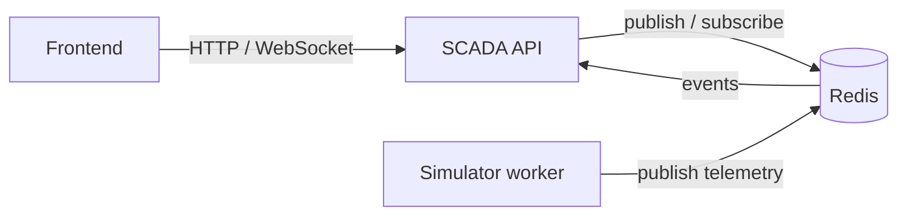

# Project architecture

KitchenOS SCADA is split into separate projects so the API, simulator runtime, shared message contracts, and tests have clear ownership.

## Project split

```text
backend/
├── kitchenOS_Scada.Api/
│   └── ASP.NET Core HTTP and WebSocket API
├── kitchenOS.Simulator/
│   └── Generic Host background worker that simulates devices
├── kitchenOS_Scada.Contract/
│   └── Shared event, message, enum, and command DTOs
├── kitchenOS_Scada.Api.Tests/
│   └── API, simulator, and simulated-device tests
└── kitchenOS_Scada.slnx
```

The solution file includes all four projects:

- [kitchenOS_Scada.Api](../backend/kitchenOS_Scada.Api/kitchenOS_Scada.Api.csproj) owns HTTP endpoints, WebSockets, CORS, and client notifications.
- [kitchenOS.Simulator](../backend/kitchenOS.Simulator/kitchenOS.Simulator.csproj) owns the simulator executable and device simulation loop.
- [kitchenOS_Scada.Contract](../backend/kitchenOS_Scada.Contract/kitchenOS_Scada.Contract.csproj) owns types shared across processes.
- [kitchenOS_Scada.Api.Tests](../backend/kitchenOS_Scada.Api.Tests/kitchenOS_Scada.Api.Tests.csproj) validates the API and simulator behavior.

## API project

The API uses `Microsoft.NET.Sdk.Web` because it is the web application. It:

- Serves `/health` and `/devices`.
- Hosts the `/ws` WebSocket endpoint.
- Publishes and subscribes to Redis messages.
- Converts incoming `EventEnvelope` messages into WebSocket notifications.
- Uses the simulator assembly for shared device behavior and device descriptions.

The API subscribes to the concrete `EventEnvelope` type rather than the `IEvent` interface. `System.Text.Json` cannot deserialize an interface without polymorphic metadata for the root object, while Redis publishes concrete event envelopes.

## Simulator project

The simulator uses the regular `Microsoft.NET.Sdk`, not the Web SDK. It is a worker process and does not expose HTTP endpoints.

The executable uses the .NET Generic Host:

1. `Program.cs` creates a `HostApplicationBuilder`.
2. Redis and the message bus are registered with dependency injection.
3. `SimulatorWorker` is registered with `AddHostedService`.
4. The host starts the worker and manages its cancellation lifecycle.
5. The worker loads `SimulatorFiles/devices.json` and `simulation.json`.
6. `DeviceSimulator` starts one simulation loop per configured device and publishes telemetry to Redis.

The simulator has no HTTP routes and publishes no ports. Its only external dependency is Redis.

## Shared contracts

The contract project is referenced by both the API and simulator. It contains the types that cross the Redis and WebSocket boundaries, including:

- `IEvent` and `EventEnvelope`.
- `IMessage`, `TelemetryBody`, `TelemetryPoint`, and `CommandResultBody`.
- `DeviceCommand` and `CommandArguments`.
- Shared enums such as `DeviceTypes`.

Message DTOs must be defined once in the contract project. Duplicating `TelemetryBody`, `CommandResultBody`, or `EventEnvelope` in the simulator creates different CLR types and breaks `System.Text.Json` polymorphic serialization.

Device IDs are represented as strings throughout the simulator and event contracts. The simulator accepts an ID from the device fixture and generates one when the fixture omits it. `description` and `deviceId` are optional in loader input; `deviceName` and `deviceType` remain required.

## Runtime topology



The API and simulator run as separate processes but share the `kitchenos:events` and `kitchenos:commands` Redis channels. The API does not start the simulator worker inside its web process.

## Docker Compose

[docker-compose.yml](../docker-compose.yml) runs four development services:

- `redis`: Redis Pub/Sub on the internal Compose network.
- `backend`: the API on `http://localhost:8080`.
- `simulator`: the background worker, with no published HTTP port.
- `frontend`: the operator interface on `http://localhost:3020`.

Useful commands:

```bash
make up
docker compose logs -f simulator
docker compose logs -f backend
curl http://localhost:8080/health
curl http://localhost:8080/devices
```

Simulator startup should produce device-update logs. API health only confirms that the API is running; it does not prove that the simulator worker is running. Check the simulator container logs or Redis event flow separately.

## Tests

The test project references the API, simulator, and contract projects. Simulator tests use the `kitchenOS.Simulator` namespace for `DeviceSimulator`, the shared device namespace for device implementations, and the contract namespaces for event DTOs.

The simulator tests cover loading, replacing configurations, publishing telemetry, lifecycle behavior, and device-specific behavior. Test fixtures may omit optional `description` and `deviceId` fields because the loader supplies safe defaults.

Run the suite in the development container with:

```bash
make test
```
